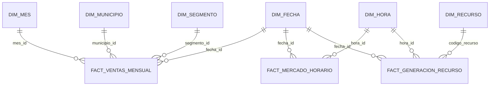

# Modelo dimensional de la capa oro

El esquema estrella integra las ventas mensuales de EnerAndes con el mercado
eléctrico horario de XM y la generación por recurso. El calendario incorpora
el ONI y su fase ENSO; sus fechas cubren el rango de todas las fuentes cargadas.

## Grano de las tablas de hechos

| Tabla | Grano | Medidas |
|---|---|---|
| `fact_ventas_mensual` | Una fila por mes, municipio, segmento y tipo de compra. | Energía en kWh, valor facturado en COP y clientes reportados. |
| `fact_mercado_horario` | Una fila por fecha, hora y código de mercado. | Precio de bolsa y demanda de XM. |
| `fact_generacion_recurso` | Una fila por fecha, hora y código de recurso/planta. | Generación reportada por XM. |

## Dimensiones

| Tabla | Grano | Uso |
|---|---|---|
| `dim_fecha` | Un día calendario. | Año, mes, trimestre, día de semana y fase ENSO asignada al mes. |
| `dim_mes` | Un mes presente en las ventas. | Relacionar ventas y resumir por periodo mensual. |
| `dim_hora` | Una hora numerada del 1 al 24. | Etiqueta de hora y franja del día para hechos horarios. |
| `dim_municipio` | Un municipio DIVIPOLA. | Contextualizar las ventas de EnerAndes. |
| `dim_segmento` | Un segmento de cliente. | Clasificar las ventas por tipo de cliente. |
| `dim_recurso` | Un código XM. | Describir plantas y otros recursos de generación. |

Los códigos de generación que no aparecen en la instantánea actual de
`ListadoRecursos` se conservan en `dim_recurso` con `en_catalogo = false` y
descripciones explícitas de “Sin información”; así se mantienen las relaciones
de los hechos históricos sin atribuirles datos inventados.
